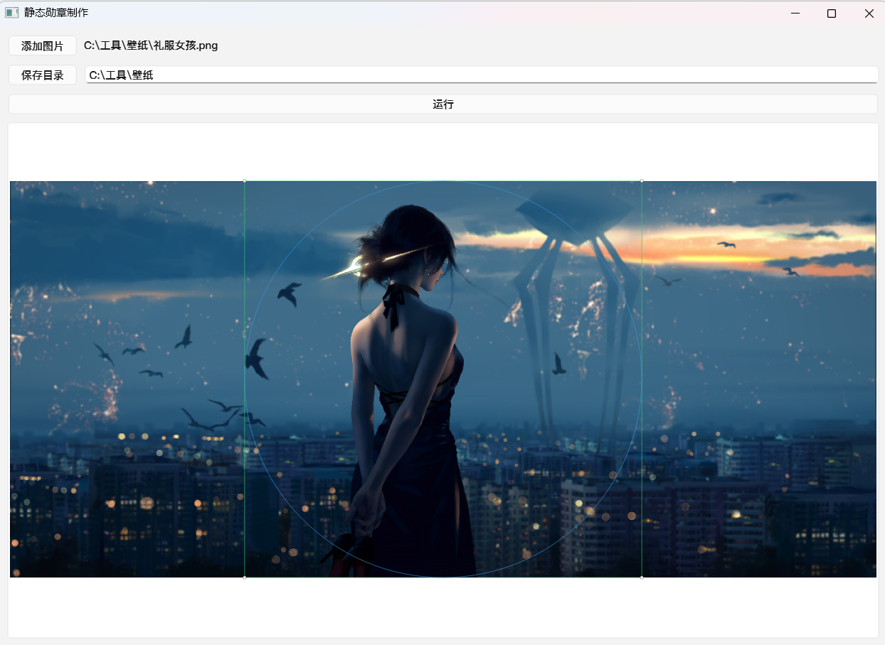

# 勋章制作

使用图形界面裁剪圆形勋章：选一张图片或一段视频，拖动/缩放正方形裁剪框（内切圆会同步显示），一键导出圆形透明背景的 WebP。
能直接裁剪圆形的软件比较少，PS又比较大，所以写了这个软件。


## 功能

静态勋章（图片）：

- 添加图片并显示
- 正方形裁剪框：可拖动/缩放，保持正方形且不超出原图
- 圆形裁剪框：内切正方形裁剪框（仅用于预览/导出遮罩）
- 选择保存目录（默认与原图同目录）
- 输出尺寸：原始分辨率、1080 × 1080、800 × 800、600 × 600
- “限制大小”默认勾上、上限 5 MB（可以改数值或取消勾选）：导出文件保证不超过它
- 运行：按正方形裁剪并将圆形外区域置为透明，导出 WebP

动态勋章（视频）：

- 选择视频，拖动时间轴挑一帧作为预览，再按同样的方式摆正方形裁剪框
- 导出帧率（60/30/24/15 帧每秒）、起始秒、时长可填，时长留空表示整段
- 每一帧都裁成正方形、内切圆之外置为透明，导出带透明通道、无限循环播放的动态 WebP
- 输出尺寸与“限制大小”同样可用，对整段动图生效
- 导出在后台进行，有进度条，运行按钮会变成“取消”

导出文件默认命名为 `原文件名.webp`；若已存在，会自动追加 `_1`、`_2` 后缀避免覆盖。

两项限制都不改变裁剪框里的构图：输出尺寸只决定最终正方形的边长，体积上限只决定压缩力度。

界面按 macOS 表单的习惯排：模式切换在标题栏正中，源文件/保存目录/输出尺寸/动图参数对齐成两列，
运行按钮是默认按钮（回车即导出）；画布是一块圆角取景区，内切圆以外压暗，左上角标出
`裁剪尺寸 → 输出尺寸`，导出进度是贴在画布顶边的一条细进度条。

## Swift 版（当前实现）

- Swift 5 + AppKit，没有第三方依赖；核心逻辑（裁剪几何、导出、命名）在 `StaticBadgeCore`，可单独测试。
- 产物是 arm64 + x86_64 通用二进制，Apple 芯片和 Intel Mac 都能直接运行，最低系统 macOS 12。
- WebP 编码内嵌了 libwebp 1.5.0 源码：macOS 的 ImageIO 不支持写 WebP（`CGImageDestinationCopyTypeIdentifiers()` 的列表里没有 `public.webp`），所以只能自带编码器。解码仍走系统的 ImageIO，png / jpg / bmp / tiff / webp / heic 都能读，EXIF 方向会自动摆正。
- 动图用同一份 libwebp 的 `WebPAnimEncoder`，视频解码用系统的 AVFoundation，所以仍然没有第三方依赖。

### 动态勋章是怎么走通的

- 预览帧走 `AVAssetImageGenerator`（精确取帧，自动应用 `preferredTransform`），导出走 `AVAssetReader` 顺序解码，两条路落在同一个“摆正后的像素”坐标空间里，裁剪框对两者通用。
- 逐帧读出的 `CVPixelBuffer` 用 `VTCreateCGImageFromCVPixelBuffer` 转成 `CGImage`，这样像素缓冲自带的色彩信息不会被丢掉；`preferredTransform` 由 `BadgeCanvas.drawVideoFrame` 手动套用。注意 AVFoundation 是按“媒体像素空间（左上原点）”解释这个矩阵的，而 Core Graphics 的绘制空间 y 轴朝上，两头各翻一次 y，方向才不会反过来。
- 每一帧和静态图片走同一段遮罩代码（`BadgeCanvas`），两种勋章的圆边表现完全一致。
- 帧时长是 `1/帧率`，并按累计时间点取整避免误差累加；内容完全相同的相邻帧会被 libwebp 合并成一帧，所以文件里实际帧数可能少于导出的帧数。
- 60 帧/秒时帧间隔只有 16~17 毫秒，低于不少播放器允许的最小间隔（常见是 20 毫秒），各家播放器里的实际播放速度可能略有出入。
- 导出在后台队列进行，逐帧检查取消标记，UI 只做进度回传。

### 输出尺寸与体积上限

- 输出尺寸由导出画布的缩放矩阵完成：先按裁剪框坐标画，再由 CTM 整体放大/缩小到目标边长，圆边依旧是抗锯齿的。缩放时把 `interpolationQuality` 交给 Core Graphics 挑滤波器，1:1 时保持 `.none` 白白重采样。
- libwebp 没有目标体积模式，所以“限制大小”靠 `QualitySearch` 试探：先按画质 100 编一次，超限就再探 40，之后用 `体积 ≈ A × 画质^b` 这条幂律反解一个贴着上限的画质，猜歪了就在“塞得进/塞不进”的区间里对半折，最多 5 次。
- 静态图片每次只是一次编码，代价可以忽略；动图每次都要把整段视频重新解码、重画、重编一遍，所以进度条是按“第几次压缩”折算的。
- 上限实在塞不下（连画质 1 都不够）时会直接报错，并告知最低能压到多大，让用户去调尺寸、帧率或时长。

### 开发与测试

```bash
swift build                              # 调试构建
swift test                               # 40 项单元测试（裁剪规则、圆形遮罩、方向、命名、动图、尺寸与体积上限）
swift run                                # 直接跑界面，不需要先打包
```

### 打包

```bash
chmod +x build_swift.sh
./build_swift.sh            # 通用包（arm64 + x86_64）
./build_swift.sh --host     # 只编当前架构，调试时更快
```

产物：

- `dist_swift/勋章制作.app`
- `dist_swift/勋章制作-mac-universal.zip`（建议分发这个压缩包）

打包脚本会做通用构建、组装 `.app`、写入 `Info.plist` 并做 ad-hoc 签名。未签名应用在其他电脑上首次打开可能会被 Gatekeeper 拦截，需要右键“打开”或在系统设置中允许。

应用图标取自根目录的 `1.webp`：打包时用 `tools/make-icns.swift` 缩放出 10 个尺寸，再交给 `iconutil` 合成 `Sources/StaticBadge/Resources/AppIcon.icns`。图标源图按 `1.icns`、`1.webp`、`1.png` 的顺序查找，三者都没有时用 `tools/make-icon.swift` 画一张兜底图标。换图标只要替换根目录的源图，然后重新执行 `./build_swift.sh`。

### 目录

```text
Package.swift                     Swift 工程定义
Sources/CWebP/                    内嵌的 libwebp 源码 + 一层精简 C 封装
Sources/StaticBadgeCore/          裁剪几何、图片/视频解码、圆形遮罩导出、静态与动态导出、体积上限、文件名递增
Sources/StaticBadge/              AppKit 界面（模式切换、两个页面、菜单、画布）
Tests/StaticBadgeCoreTests/       核心逻辑测试（含现场生成的测试视频）
tools/make-icns.swift             由源图生成 10 个尺寸的应用图标
tools/make-icon.swift             画一张兜底应用图标
build_swift.sh                    通用包打包脚本
1.webp                            应用图标源图（不参与界面显示）
```

### 不入库的文件

`.gitignore` 已经排除掉构建产物和本地环境，提交时不用管：

- Swift：`.build/`、`dist_swift/`、`DerivedData/`、`Package.resolved`
- Python：`.venv/`、`dist_x64/`、`build_x64/`、`.pyinstaller/`、`__pycache__/`、`*.pyc`
- 系统与其它：`.DS_Store`；本地图标 `1.icns`（想固定图标就换成提交 `1.webp` 这条路）

## Python 版（原实现）

```bash
python -m venv .venv
source .venv/bin/activate   # win 运行  .venv\Scripts\activate
pip install -r requirements.txt
python main.py
```

### 打包（macOS x64）

```bash
chmod +x build_macos_x64.sh
./build_macos_x64.sh
```

图标：将 `1.icns` 放在项目根目录（脚本会自动打包为应用图标）。

产物：

- `dist_x64/静态勋章制作.app`
- `dist_x64/静态勋章制作-mac-x64.zip`（建议分发这个压缩包）
